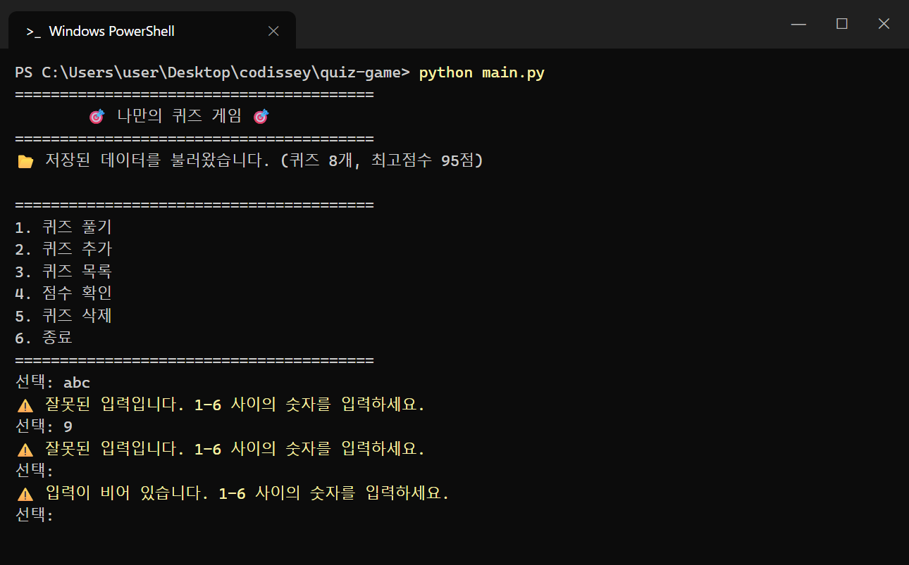
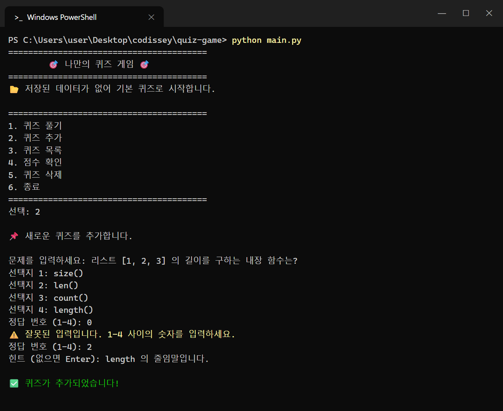
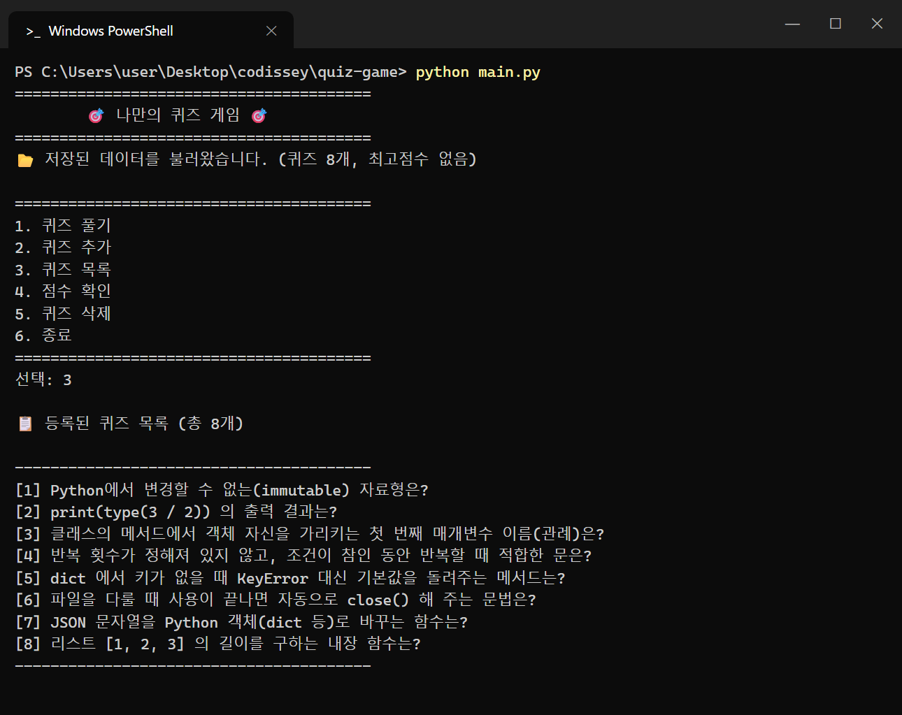
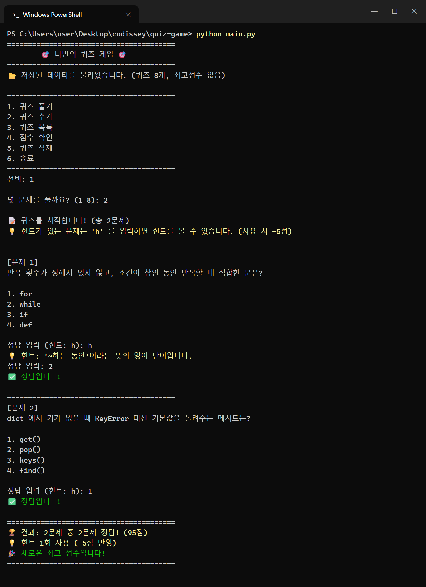
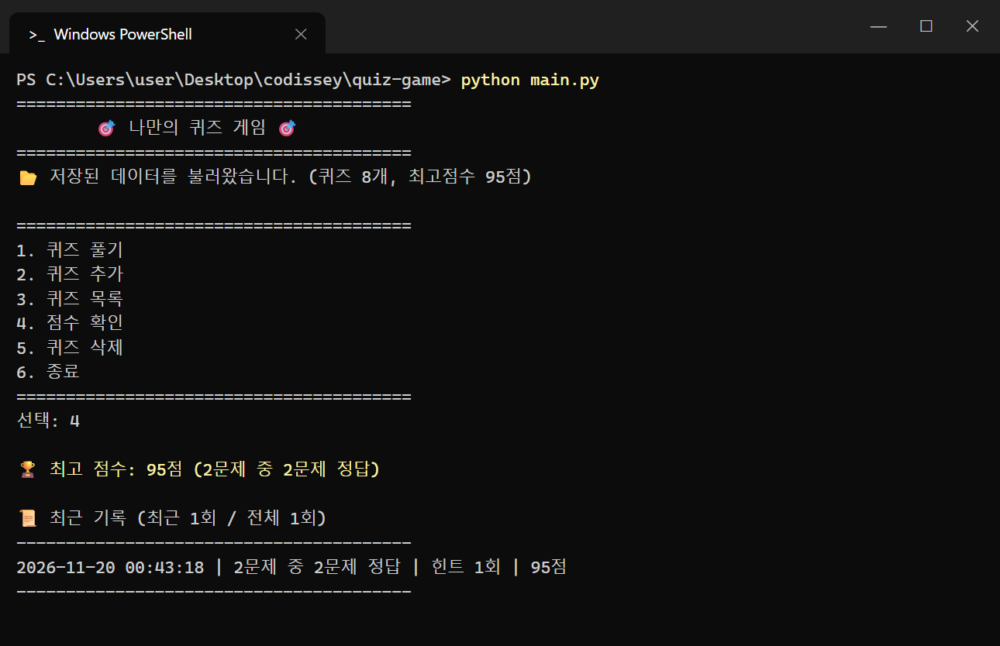
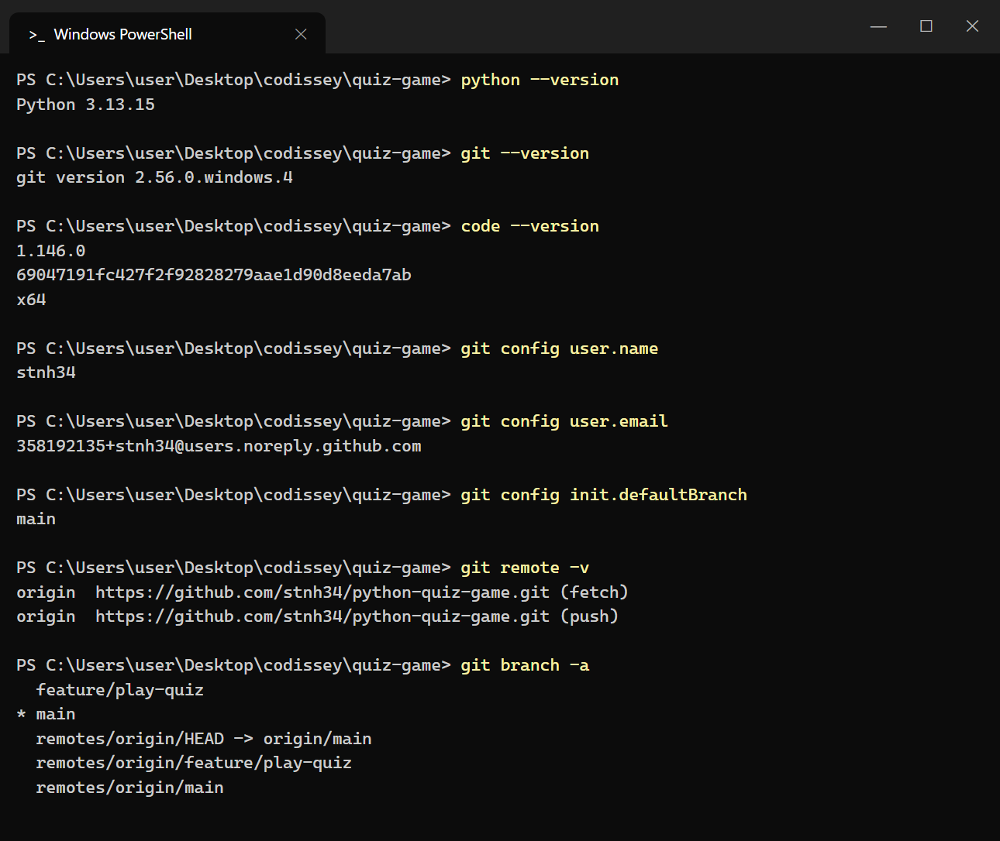
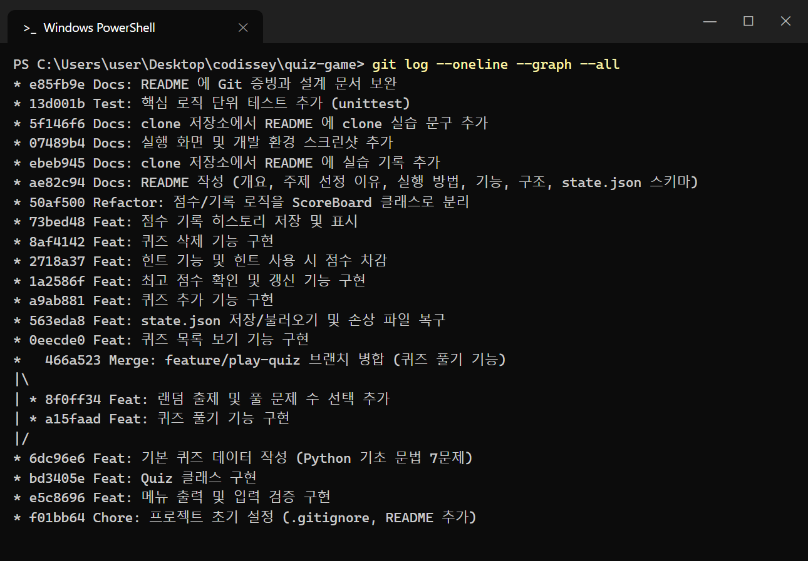

# 🎯 나만의 퀴즈 게임

## 1. 프로젝트 개요

터미널에서 동작하는 **Python 콘솔 퀴즈 게임**입니다.
메뉴에서 번호를 골라 퀴즈를 풀고, 새 퀴즈를 등록하고, 목록과 최고 점수를 확인할 수 있습니다.
퀴즈와 점수는 프로젝트 루트의 `state.json`에 저장되므로 **프로그램을 껐다 켜도 데이터가 유지**됩니다.

- 표준 라이브러리만 사용 (`json`, `random`, `datetime`, `pathlib`, `os`, `sys`)
- 역할별 클래스 분리: `Quiz`, `QuizGame`, `ScoreBoard`, `StateStorage`, `InputHandler`
- Git 브랜치 작업 → 병합, 기능 단위 커밋으로 이력 관리

## 2. 퀴즈 주제와 선정 이유

**주제: Python 기초 문법**

이 프로젝트 자체가 Python 기초(자료형, 조건/반복문, 클래스, 파일 입출력, JSON)를 익히기 위한 과제입니다.
퀴즈를 만들면서 개념을 한 번 더 정리하고, 게임을 플레이하면서 다시 복습할 수 있도록
**"만드는 과정과 푸는 과정이 모두 학습이 되는"** 주제로 선택했습니다.
기본 퀴즈 7문제가 포함되어 있고, 각 문제에는 힌트가 있습니다.

## 3. 실행 방법

**요구 사항:** Python 3.10 이상 (외부 라이브러리 설치 불필요)

```bash
git clone https://github.com/stnh34/python-quiz-game.git
cd python-quiz-game
python main.py
```

> Windows 에서 `python` 명령이 없다면 `py main.py` 로 실행합니다.

## 4. 기능 목록

| 메뉴 | 기능 | 설명 |
|---|---|---|
| 1 | 퀴즈 풀기 | 풀 문제 수 선택 → 무작위 순서로 출제 → 정답/오답 안내 → 결과(점수) 표시, 최고 점수 갱신 |
| 2 | 퀴즈 추가 | 문제, 선택지 4개, 정답 번호(1-4), 힌트(선택)를 입력받아 등록 후 즉시 저장 |
| 3 | 퀴즈 목록 | 등록된 퀴즈를 번호와 함께 출력 |
| 4 | 점수 확인 | 최고 점수(정답 수 포함)와 최근 5회 게임 기록 표시 |
| 5 | 퀴즈 삭제 | 번호 선택 + y/n 확인 후 삭제, 파일에 반영 (0 입력 시 취소) |
| 6 | 종료 | 데이터 저장 후 종료 |

**보너스 기능:** 랜덤 출제, 문제 수 선택, 힌트(`h` 입력, 1회당 -5점), 퀴즈 삭제, 점수 기록 히스토리

**입력/예외 처리**
- 모든 입력은 앞뒤 공백을 제거한 뒤 처리합니다. (` 1 ` → `1`)
- 빈 입력, 숫자가 아닌 입력(`abc`), 범위 밖 숫자(메뉴 `9`, 정답 `0`)는 안내 후 다시 입력받습니다.
- `Ctrl+C`(KeyboardInterrupt) 또는 입력 스트림 종료(EOFError) 시 안내 메시지를 출력하고 저장 후 안전하게 종료합니다.
- 퀴즈가 없을 때 풀기/목록/삭제, 아직 풀지 않았을 때 점수 확인은 안내 메시지를 출력합니다.

**점수 계산:** `round(정답 수 / 문제 수 × 100) - 힌트 사용 횟수 × 5` (최소 0점)

## 5. 파일 구조

```
python-quiz-game/
├── main.py              # 실행 진입점: state.json 경로 지정, QuizGame 실행
├── game.py              # QuizGame: 메뉴 루프, 풀기/추가/목록/점수/삭제, 저장·불러오기 조율
├── quiz.py              # Quiz: 문제/선택지/정답/힌트, 출력·정답 확인·dict 변환
├── score_board.py       # ScoreBoard: 점수 계산, 최고 점수, 게임 기록(history)
├── storage.py           # StateStorage: state.json UTF-8 읽기/쓰기, 손상 파일 백업
├── input_handler.py     # InputHandler: 공통 입력 검증 (공백/빈 입력/숫자/범위/y·n)
├── default_quizzes.py   # 기본 퀴즈 7문제 (Quiz 인스턴스)
├── tests/
│   └── test_quiz_game.py  # unittest 단위 테스트 10개
├── docs/
│   ├── screenshots/     # 실행 화면·개발 환경·git log 스크린샷
│   └── logs/
│       └── clone_pull.log # clone → push → pull 실습 터미널 로그
├── state.json           # 실행 시 자동 생성되는 데이터 파일 (Git 추적 제외)
├── .gitignore
└── README.md
```

### 5-1. 클래스 설계와 사용 이유

모든 기능을 함수 하나에 넣으면 "입력 검증 규칙 하나"만 바꿔도 게임 진행 코드 전체를 읽어야 합니다.
그래서 **바뀌는 이유가 서로 다른 것끼리 클래스로 나눴습니다.** 각 클래스는 자기 데이터(속성)와 그 데이터를 다루는 방법(메서드)을 함께 묶어(캡슐화), 바깥에서는 내부 구현을 몰라도 쓸 수 있게(추상화) 했습니다.

| 클래스 (파일) | 책임 | 추상화 — 바깥에서 보이는 것 | 재사용성 — 다시 쓰는 곳 |
|---|---|---|---|
| `Quiz` (`quiz.py`) | 퀴즈 1개의 데이터와 규칙: 선택지 4개, 정답 1~4 검증, 출력, 정답 확인, dict 변환 | `quiz.is_correct(2)` 만 호출하면 되고 정답 저장 방식은 몰라도 됨 | 기본 퀴즈 생성, 사용자 추가, state.json 로딩이 **모두 같은 생성자 검증**을 거침 |
| `InputHandler` (`input_handler.py`) | 입력 검증: 공백 제거, 빈 입력/문자/범위 밖 숫자 재입력, y/n | `read_int("선택: ", 1, 6)` 한 줄로 검증된 정수를 받음 | 메뉴 선택, 문제 수, 정답, 정답 번호 등록, 삭제 번호 — **5곳이 같은 메서드** 사용 |
| `ScoreBoard` (`score_board.py`) | 점수 계산, 최고 점수 갱신, 기록(history), 점수 직렬화 | `record_game(...)` 이 "새 최고 점수인지"만 돌려줌 | 점수 규칙이 바뀌어도 이 파일만 수정. 단위 테스트에서 단독으로 검증 |
| `StateStorage` (`storage.py`) | 파일 I/O: UTF-8 JSON 읽기/쓰기, 임시 파일 교체, 손상 파일 백업 | `load()` → dict 또는 None, `save(dict)` | 저장 형식(JSON→SQLite 등)을 바꿔도 같은 `load/save` 메서드만 맞추면 됨 |
| `QuizGame` (`game.py`) | 흐름 조율: 메뉴 루프, 각 기능 실행 순서, 저장 시점 결정, Ctrl+C/EOF 처리 | `QuizGame(path).run()` | 위 4개 클래스를 조합만 하고 세부 규칙은 직접 갖지 않음 |

**예시 — 사용자가 정답으로 `abc` 를 입력했을 때의 흐름 (오답 판정 포함)**

1. `QuizGame.ask_answer()` → `InputHandler.read_int("정답 입력: ", 1, 4)` 호출
2. `InputHandler`: `int("abc")` 실패 → `⚠️ 잘못된 입력입니다. 1-4 사이의 숫자를 입력하세요.` 출력 후 다시 입력
3. 사용자가 `1` 입력 → 정수 1 반환
4. `Quiz.is_correct(1)` → 정답이 3이면 `False`
5. `QuizGame` 이 `❌ 오답입니다. 정답은 3. tuple 입니다.` 출력, 다음 문제로 진행
6. 모든 문제 후 `ScoreBoard.calculate_score()` → `record_game()` → `StateStorage.save()`

## 6. 데이터 파일 설명 (`state.json`)

- **경로:** 프로젝트 루트 `./state.json` (`main.py` 와 같은 폴더, 실행 위치와 무관)
- **인코딩:** UTF-8 (`ensure_ascii=False` 로 한글을 그대로 저장)
- **역할:** 퀴즈 목록, 최고 점수, 게임 기록을 보관하여 재실행 시에도 데이터 유지
- **생성/저장 시점:** 첫 실행 시 기본 퀴즈로 생성 → 퀴즈 추가/삭제, 퀴즈 풀이 종료, 프로그램 종료(중단 포함) 시 저장
- **안전 저장:** `state.json.tmp` 에 먼저 쓴 뒤 교체하여 저장 도중 중단돼도 기존 파일이 깨지지 않음
- **예외 처리**
  - 파일 없음 → 기본 퀴즈 데이터로 시작
  - JSON 형식 오류 / 필드 형식 오류 → 안내 메시지 출력, 기존 파일을 `state.json.bak` 으로 보관한 뒤 기본 데이터로 복구
  - 쓰기 실패 → 안내 메시지 출력 후 게임은 계속 진행
- **JSON 을 선택한 이유:** 사람이 메모장으로 열어 바로 읽고 고칠 수 있는 텍스트 형식이고, Python 의 `dict`/`list` 와 구조가 1:1 로 대응하며, 표준 라이브러리 `json` 만으로 읽고 쓸 수 있기 때문입니다.

**첫 실행 직후 생성되는 state.json (요약)** — 기본 퀴즈 7개, 아직 풀지 않았으므로 점수는 `null`

```json
{
    "quizzes": [
        {"question": "Python에서 변경할 수 없는(immutable) 자료형은?", "choices": ["list", "dict", "tuple", "set"], "answer": 3, "hint": "소괄호 ( ) 로 만드는 자료형입니다."},
        "... 기본 퀴즈 6개 더 ..."
    ],
    "best_score": null,
    "best_detail": null,
    "history": []
}
```

**스키마**

| 키 | 타입 | 설명 |
|---|---|---|
| `quizzes` | list | 퀴즈 목록 |
| `quizzes[].question` | str | 문제 |
| `quizzes[].choices` | list[str] | 선택지 4개 |
| `quizzes[].answer` | int | 정답 번호 (1~4) |
| `quizzes[].hint` | str | 힌트 (없으면 빈 문자열, 생략 가능) |
| `best_score` | int \| null | 최고 점수 (0~100), 아직 풀지 않았으면 `null` |
| `best_detail` | object \| null | 최고 점수 당시 `{"correct": 정답 수, "total": 문제 수}` |
| `history` | list | 게임 기록 `{"played_at", "total", "correct", "hints_used", "score"}` |

**예시**

```json
{
    "quizzes": [
        {
            "question": "Python에서 변경할 수 없는(immutable) 자료형은?",
            "choices": ["list", "dict", "tuple", "set"],
            "answer": 3,
            "hint": "소괄호 ( ) 로 만드는 자료형입니다."
        }
    ],
    "best_score": 80,
    "best_detail": {"correct": 4, "total": 5},
    "history": [
        {"played_at": "2026-11-20 00:30:00", "total": 5, "correct": 4, "hints_used": 0, "score": 80}
    ]
}
```

## 7. 실행 화면 예시

```
========================================
        🎯 나만의 퀴즈 게임 🎯
========================================
📂 저장된 데이터를 불러왔습니다. (퀴즈 7개, 최고점수 80점)

========================================
1. 퀴즈 풀기
2. 퀴즈 추가
3. 퀴즈 목록
4. 점수 확인
5. 퀴즈 삭제
6. 종료
========================================
선택: abc
⚠️ 잘못된 입력입니다. 1-6 사이의 숫자를 입력하세요.
```

### 스크린샷

| 화면 | 이미지 |
|---|---|
| 메뉴 + 잘못된 입력 처리 |  |
| 퀴즈 추가 |  |
| 퀴즈 목록 |  |
| 퀴즈 풀기 (힌트 사용) |  |
| 점수 확인 + 기록 |  |
| 개발 환경 (Python / Git / VSCode 버전, Git 설정) |  |
| `git log --oneline --graph` |  |

## 8. 테스트

```bash
python -m unittest discover -s tests -v
```

기본 퀴즈 5개 이상, Quiz 검증, 점수 계산(힌트 차감), 최고 점수 갱신, state.json 저장/재로딩/UTF-8/손상 복구를 검증합니다. (10개 테스트 통과)

## 9. Git 작업 기록 (증빙)

### 9-1. 원격 저장소

- **GitHub:** https://github.com/stnh34/python-quiz-game
- **커밋 수:** 21개 (main 기준, 이 README 작성 시점)

```
$ git remote -v
origin	https://github.com/stnh34/python-quiz-game.git (fetch)
origin	https://github.com/stnh34/python-quiz-game.git (push)
```

### 9-2. 커밋 규칙

- 기능 단위 커밋, 메시지 앞에 `Feat:` / `Fix:` / `Refactor:` / `Docs:` / `Test:` / `Chore:` 를 붙이고 본문에 변경 요약을 적습니다.
- 사용한 Git 명령: `init`, `add`, `commit`, `push`, `pull`, `checkout`(`-b` 로 브랜치 생성), `merge`, `clone`

### 9-3. 브랜치 생성 및 병합 그래프

`feature/play-quiz` 브랜치를 `git checkout -b` 로 만들어 퀴즈 풀기 기능(커밋 2개)을 개발한 뒤,
`main` 으로 돌아와 `git merge --no-ff` 로 병합했습니다. 아래 그래프의 `Merge:` 커밋과 갈라진 선이 그 기록입니다.

```
$ git log --oneline --graph --all
* 13d001b Test: 핵심 로직 단위 테스트 추가 (unittest)
* 5f146f6 Docs: clone 저장소에서 README 에 clone 실습 문구 추가
* 07489b4 Docs: 실행 화면 및 개발 환경 스크린샷 추가
* ebeb945 Docs: clone 저장소에서 README 에 실습 기록 추가
* ae82c94 Docs: README 작성 (개요, 주제 선정 이유, 실행 방법, 기능, 구조, state.json 스키마)
* 50af500 Refactor: 점수/기록 로직을 ScoreBoard 클래스로 분리
* 73bed48 Feat: 점수 기록 히스토리 저장 및 표시
* 8af4142 Feat: 퀴즈 삭제 기능 구현
* 2718a37 Feat: 힌트 기능 및 힌트 사용 시 점수 차감
* 1a2586f Feat: 최고 점수 확인 및 갱신 기능 구현
* a9ab881 Feat: 퀴즈 추가 기능 구현
* 563eda8 Feat: state.json 저장/불러오기 및 손상 파일 복구
* 0eecde0 Feat: 퀴즈 목록 보기 기능 구현
*   466a523 Merge: feature/play-quiz 브랜치 병합 (퀴즈 풀기 기능)
|\  
| * 8f0ff34 Feat: 랜덤 출제 및 풀 문제 수 선택 추가
| * a15faad Feat: 퀴즈 풀기 기능 구현
|/  
* 6dc96e6 Feat: 기본 퀴즈 데이터 작성 (Python 기초 문법 7문제)
* bd3405e Feat: Quiz 클래스 구현
* e5c8696 Feat: 메뉴 출력 및 입력 검증 구현
* f01bb64 Chore: 프로젝트 초기 설정 (.gitignore, README 추가)
```

### 9-4. clone / pull 실습

1. 미션 저장소를 별도 디렉터리 `quiz-game-clone2` 에 `git clone`
2. 복제본에서 README 에 한 줄 추가 → `git commit` → `git push`
3. 기존 작업 디렉터리 `quiz-game` 에서 `git pull` → Fast-forward 로 반영
4. `git log`, `tail README.md` 로 반영 확인

전체 터미널 출력: [`docs/logs/clone_pull.log`](docs/logs/clone_pull.log)

```
# clone / pull 실습 로그 (2026-11-20 00:49:49)

## 1) 별도 디렉터리에 clone
$ git clone https://github.com/stnh34/python-quiz-game.git quiz-game-clone2
Cloning into 'quiz-game-clone2'...

## 2) clone 한 저장소에서 README 수정 → commit → push
$ git add README.md

$ git commit -m Docs: clone 저장소에서 README 에 clone 실습 문구 추가
[main 5f146f6] Docs: clone 저장소에서 README 에 clone 실습 문구 추가
 1 file changed, 2 insertions(+)

$ git push origin main
To https://github.com/stnh34/python-quiz-game.git
   07489b4..5f146f6  main -> main

## 3) 기존 작업 디렉터리(quiz-game)에서 pull
$ git pull origin main
From https://github.com/stnh34/python-quiz-game
 * branch            main       -> FETCH_HEAD
   07489b4..5f146f6  main       -> origin/main
Updating 07489b4..5f146f6
Fast-forward
 README.md | 2 ++
 1 file changed, 2 insertions(+)

## 4) 반영 확인
$ git log --oneline -3
5f146f6 Docs: clone 저장소에서 README 에 clone 실습 문구 추가
07489b4 Docs: 실행 화면 및 개발 환경 스크린샷 추가
ebeb945 Docs: clone 저장소에서 README 에 실습 기록 추가

$ tail -n 1 README.md
> clone 실습: 이 줄은 별도 디렉터리(quiz-game-clone2)에서 추가하고 push 했습니다. (2026-11-20)
```

## 10. 운영 시 주의사항

- **동시 실행:** 프로그램 두 개를 동시에 실행하면 마지막에 저장한 쪽이 `state.json` 을 덮어씁니다. (파일 잠금 없음) 한 번에 하나만 실행하세요.
- **권한 오류:** 저장 시 `⚠️ 데이터를 저장하지 못했습니다` 가 나오면 프로젝트 폴더 쓰기 권한, 파일이 읽기 전용인지, 다른 프로그램(편집기, 백신)이 파일을 잠그고 있는지 확인하세요. 게임은 계속되지만 그 변경은 저장되지 않습니다.
- **손상 파일 백업 정책:** 손상이 감지될 때마다 `state.json.bak` **1개만** 보관합니다. (새 손상이 생기면 이전 백업을 덮어씀) 복구하려면 `.bak` 을 직접 고친 뒤 `state.json` 으로 이름을 바꾸세요.
- **종료 신호:** `Ctrl+C`(KeyboardInterrupt)와 입력 종료(EOF)는 저장 후 종료합니다. 작업 관리자 강제 종료나 `SIGTERM` 은 따로 처리하지 않습니다. 다만 변경이 있을 때마다 바로 저장하고 임시 파일 교체 방식으로 쓰므로, 강제 종료돼도 마지막 저장 상태는 깨지지 않습니다.

## 11. 성능과 한계

`state.json` 전체를 한 번에 메모리로 읽고, 저장할 때도 전체를 다시 씁니다. 실제로 측정한 결과입니다. (Python 3.13, Windows 11)

| 퀴즈 수 | 파일 크기 | 저장 | 불러오기 | 최대 메모리 |
|---|---|---|---|---|
| 1,000개 | 344KB | 8ms | 32ms | 1.5MB |
| 10,000개 | 3.4MB | 67ms | 121ms | 15MB |

- 퀴즈 1,000개 정도는 체감 지연이 없습니다.
- 한계: 퀴즈 1개를 추가하거나 삭제해도 파일 전체를 다시 씁니다. 목록 보기는 전체를 한 화면에 출력하므로 수백 개 이상이면 보기 어렵습니다. `history` 는 계속 늘어납니다.
- 대안: 수만 개 이상이 되거나 여러 사람이 함께 쓴다면 표준 라이브러리 `sqlite3` 로 바꿉니다. 행 단위로 추가/삭제하고 트랜잭션으로 동시 접근을 처리할 수 있습니다. 그 밖에 목록 페이지 나누기, `history` 최근 N개만 보관하는 방법이 있습니다. 저장소 교체는 `StateStorage` 만 바꾸면 됩니다. (아래 12장 참고)

## 12. 요구사항 변경 시 수정 범위

| 변경 요구 | 수정할 곳 | 영향 없는 곳 |
|---|---|---|
| 점수 계산 방식 변경 (예: 힌트 차감 10점, 문제별 배점) | `score_board.py` — `HINT_PENALTY`, `calculate_score()` | Quiz, Storage, 입력 처리 |
| 선택지 개수 변경 (4개 → 5개) | `quiz.py` — `Quiz.CHOICE_COUNT`, `default_quizzes.py` 의 데이터 | 입력 범위·출력은 `CHOICE_COUNT` 를 따라감 |
| 퀴즈에 새 속성 추가 (예: 난이도, 카테고리) | `quiz.py` — `__init__`, `to_dict()`, `from_dict()` (`.get()` 기본값으로 예전 파일 호환), `game.py` — `add_quiz()` 입력 | Storage, ScoreBoard |
| 저장 방식 변경 (JSON → SQLite) | `storage.py` — `StateStorage.load()/save()` 를 같은 시그니처로 구현 | Quiz, ScoreBoard, QuizGame |
| 메뉴 추가 (예: 퀴즈 수정) | `game.py` — `MENU_ITEMS`, `handle_menu()`, 새 메서드 | 나머지 클래스 |
| 입력 규칙 변경 (예: `q` 입력 시 메뉴로 돌아가기) | `input_handler.py` | 각 기능 코드 |

변경 후에는 `python -m unittest discover -s tests -v` 로 회귀 테스트를 실행합니다.
